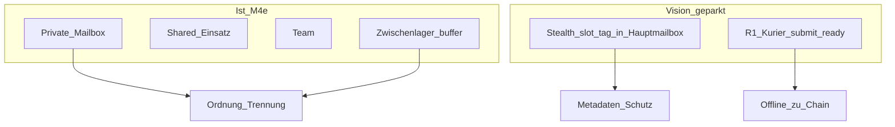

# Kontakt-Mailboxen — Zielbild (4 Slots + Send-Auswahl)

**Stand:** 2026-11-28 (Begriffsklärung Aktenschrank vs. Stealth)  
**Status M4e:** **Umgesetzt** — Telefonbuch vier Felder, Send-Dropdown „Ziel-Postfach“, API/JSON `mailbox*Id`, QR `ms`/`m`/`mt`/`mb`.

---

## Drei Dinge — nicht vermischen (kritisch 2026-11-28)

| Konzept | Problem das es löst | Ist? | Explorer sieht Empfänger? |
|---------|---------------------|------|---------------------------|
| **A · Aktenschrank (M4e)** | Ordnung: 4 Ziel-Postfächer pro Kontakt | **Code Ist**; **UX-Feinschliff → ganz hinten** (User 2026-11-28) | Ja — Owner sichtbar |
| **B · Stealth / `slot_tag`** | Metadaten: Empfänger in der **Haupt-Mailbox** hinter Ableitung verstecken | **Nein** (Vision, **vor** Schubladen-UX) | Soll: nein (nur `slot_tag`) |
| **C · R1-Kurier** | Offline signierte TX → Relayer reicht ein (Gas) | Beta-Dialog, **geparkt** | TX-Workflow, kein Chat-Postfach |

**„Blind Slot“ war Verwechslung:** Umgangssprachlich oft mit **Stealth** gemeint; im Code heißt der 4. M4e-Slot **`buffer` / Zwischenlager** (= Reserve-Schublade im Aktenschrank, **keine** Tarnung).

---

## A · Aktenschrank (Ist) — wann / wie / welche Mailbox

Pro Kontakt (Wallet `0x…`) vier **optionale** Object-IDs:

| Slot | Rolle | Wann brauchen | Aktivierung |
|------|--------|---------------|-------------|
| **private** | Private Mailbox des Partners | 1:1, burnbar, „nur wir“ | Telefonbuch → Erweitert → Privat; Composer Ziel |
| **shared** | Einsatz-/Hauptpostfach | Team/Einsatz liest mit | Slot shared / Server-`MAILBOX_ID` |
| **team** | Team-Mailbox | Team-Kanal | Slot team |
| **buffer** (Zwischenlager) | Zweitpfad / Übergang, wenn Ziel noch unklar | selten; Sortierung später | Slot buffer setzen + Composer |

**Zusätzlich (kein Slot):** **Event** = flüchtig an Wallet, kein Postfach-Objekt (Consumer-Default).

**Preset-Buttons (Aktenschrank):** **Jetzt nicht nötig.** Es gibt schon Defaults (`event` Consumer, `own` Einsatz) + manuelles Dropdown. Mehr Buttons = Doppel-UX. Reicht: klare Labels + Handbuch.

**Senden:** Composer „Speicher auf der Chain“. **Empfang:** Empfänger muss **dieselbe** Mailbox lesen, in die geschrieben wurde.

---

## B · Stealth `slot_tag` (Spec 2026-11-28 — Implementierung geparkt)

**Kanonische Spec:** **`docs/STEALTH-SLOT-TAG-SPEC.md`** (Ableitung, Purge-Skizze, Lookahead, Client-Regeln, Nicht-Ziele).

**Kurz:** Nachricht in **Haupt-Mailbox** (`MAILBOX_ID` / shared), Index = `slot_tag`; Empfänger Lookahead + optional Purge. Opt-in „Diskret“, Default aus.

**Nicht jetzt:** Move/UI — erst nach Spec-Review + User-OK.

---

## C · R1-Kurier (geparkt)

Offline→Relayer→`submit_ready`. **Kein** Ersatz für A oder B. Gas/Relayer-Policy offen → keine Preset-Buttons.

---

## FAQ Kurz

| Ziel | Wann | Aktivierung (Ist) |
|------|------|-------------------|
| **Event** | Alltag 1:1 | Composer → Event |
| **Private Mailbox** | 1:1 Anker/Burn | Slot private |
| **Einsatz/shared** | Team liest mit | Slot shared |
| **Team** | Team-Postfach | Slot team |
| **Zwischenlager (buffer)** | Übergang/Reserve | Slot buffer — **nicht** Stealth |
| **Stealth `slot_tag`** | Metadaten-Schutz | **Geparkt** |
| **R1 Kurier** | Offline-TX | **Geparkt** |

**Nicht verwechseln:**

- **Gruppenchat (M2a)** = Kanal + Mitgliederfilter  
- **„4 aktiv bei mir“** = `my-mailbox-active.ts`  
- **Stealth** ≠ **Zwischenlager** ≠ **Kurier**

---

## Lieferung (Vorschlag)

1. Schema: `ContactMeshEntry` + API `contact-label` + QR `docs/QR-CONTACT-SCHEMA-V2.md`  
2. Telefonbuch-UI: vier Felder + Kurzlabels  
3. `resolveOutboundMailboxObjectId` + Send-Panel: explizite Zielwahl  
4. Vitest + `docs/SENDEWEGE-KANAL-MAILBOX-UEBERSICHT.md` aktualisieren  

**Ist (Stand 2026-11):** vier Slot-Felder + Send-Zielwahl + Composer „Speicher auf der Chain“ — siehe `contact-phonebook-contact-dialog.tsx` / `contact-mailbox-slots.ts`. (Ältere „ein Feld“-Zeile war Pre-M4e.)
